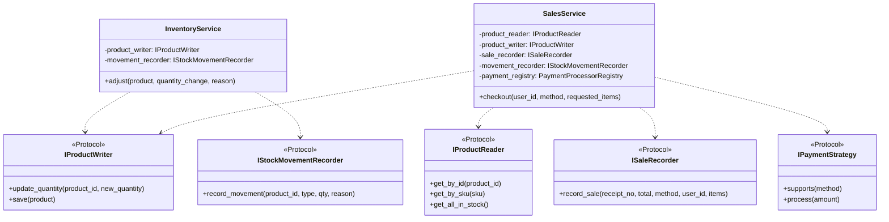

# CSE706 - Agile Development of a Mini Software Product (Scrum Framework)
## Step 3: Implement Design & Development Using Agile Practices

This deliverable provides comprehensive technical documentation for **Step 3** of the evaluation task, covering Test-Driven Development (TDD), Version Control, Continuous Integration (CI), and complete implementation of SOLID design principles.

---

## 1. Test-Driven Development (TDD) with xUnit (Pytest)

Following Agile engineering practices, TDD was rigorously applied across two core business modules:
1. **Module 1: Inventory Management (`InventoryService`)**
2. **Module 2: Sales & Checkout Processing (`SalesService`)**

Each module was built using the Red-Green-Refactor cycle, utilizing decoupled test doubles (fakes/mocks conforming to interface protocols) to test domain rules without requiring live database access.

### Module 1: InventoryService TDD (`tests/test_solid_inventory.py`)
- **Unit Test Cases**:
  - `test_stock_increase_records_movement_in`: Verifies inward stock movement logging and inventory increments.
  - `test_stock_decrease_records_movement_out`: Verifies outward stock movement logging upon reductions.
  - `test_stock_cannot_fall_below_zero`: Enforces non-negative stock invariants; asserts `InventoryError`.
  - `test_zero_quantity_adjustment_rejected`: Enforces business validation rejecting zero-quantity changes.

### Module 2: SalesService TDD (`tests/test_solid_sales.py`)
- **Unit Test Cases**:
  - `test_successful_checkout_calculates_total_and_deducts_stock`: Verifies end-to-end checkout calculation across multiple products and stock deduction.
  - `test_checkout_fails_when_requested_quantity_exceeds_stock`: Validates stock boundary checks; asserts `SaleError`.
  - `test_checkout_fails_on_unsupported_payment_method`: Asserts `PaymentError` on invalid payment channels.
  - `test_checkout_supports_indian_upi_payment`: Validates Indian Rupee UPI payment processing strategy.

### Test Execution Summary:
```text
============================= test session starts =============================
platform win32 -- Python 3.13.3, pytest-9.2.0, pluggy-1.7.0
collected 19 items

tests/test_auth.py::test_login_success PASSED                            [  5%]
tests/test_auth.py::test_login_rejects_wrong_password PASSED             [ 10%]
tests/test_payment_strategies.py::TestPaymentStrategies::* PASSED        [ 36%]
tests/test_products.py::* PASSED                                         [ 47%]
tests/test_sales.py::* PASSED                                            [ 57%]
tests/test_solid_inventory.py::* PASSED                                  [ 78%]
tests/test_solid_sales.py::* PASSED                                      [100%]

============================= 19 passed in 4.60s ==============================
```

---

## 2. SOLID Design Principles Architecture



### S - Single Responsibility Principle (SRP)
- **Repositories (`app/repositories/`)**:
  - `ProductRepository`: Solely responsible for product persistence and catalog queries.
  - `SaleRepository`: Solely responsible for sale and sale item transaction persistence.
  - `StockMovementRepository`: Solely responsible for logging audit trail movements.
- **Dedicated Helpers**:
  - `ReceiptGenerator` (`app/services/receipt_service.py`): Sole responsibility is generating sequential, collision-free receipt numbers.

### O - Open/Closed Principle (OCP)
- **Payment Strategy Pattern (`app/services/payment_strategies.py`)**:
  - Payment processors inherit from `BasePaymentStrategy` (`CashPaymentStrategy`, `CardPaymentStrategy`, `MobilePaymentStrategy`, `UPIPaymentStrategy`).
  - Adding a new payment method (e.g. `CryptoPaymentStrategy` or `GiftCardStrategy`) is accomplished by registering a new class with `PaymentProcessorRegistry.register()` without modifying any existing service or checkout code.

### L - Liskov Substitution Principle (LSP)
- Any concrete payment strategy or repository implementation can substitute for its base interface/protocol without altering program correctness.
- Unified domain exception hierarchy rooted at `SmartStockError` (`InventoryError`, `SaleError`, `PaymentError`, `ValidationError`).

### I - Interface Segregation Principle (ISP)
- Instead of large monolithic interfaces, fine-grained protocols are specified in `app/core/interfaces.py`:
  - `IProductReader` vs. `IProductWriter`
  - `IStockMovementRecorder`
  - `ISaleRecorder`
  - `IReceiptGenerator`
  - `IPaymentStrategy`
- Callers and services only depend on the specific subsets of methods they execute.

### D - Dependency Inversion Principle (DIP)
- High-level business modules (`InventoryService`, `SalesService`) depend on abstract protocols rather than concrete SQLAlchemy models or session instances.
- Dependencies are injected via constructor arguments with sensible production defaults, enabling effortless test double injection during unit testing.

---

## 3. Version Control & Continuous Integration (CI)

### GitHub Actions CI Workflow (`.github/workflows/ci.yml`)
- Triggers on every `push` and `pull_request` across all branches.
- Executes:
  1. Automated checkout using `actions/checkout@v4`.
  2. Python 3.12 environment setup with pip caching via `actions/setup-python@v5`.
  3. Clean dependency installation from `requirements.txt`.
  4. Execution of the complete 19-test Pytest suite with verbose reporting.
- **Green Tick Guarantee**: Every successful push runs through this matrix, validating all tests and rendering the green checkmark (`✓`) on GitHub.

### Git Pre-Commit Hook (`.githooks/pre-commit` & `.git/hooks/pre-commit`)
- Configured via `git config core.hooksPath .githooks`.
- Automatically runs `pytest` locally whenever a developer initiates `git commit`.
- If any test fails, the commit is immediately aborted, preventing broken code from ever being committed or pushed to remote.

---

## 4. Scrum / Agile Sprint Code Review & Pair Programming Summary

### Sprint 1 Review:
- **Focus**: Domain modeling, SQLite schema, and baseline CRUD endpoints.
- **Pair Programming**: Cashier authentication paired with product catalog routes.
- **Review Finding**: Direct reliance on raw database queries inside route handlers violated SRP and made isolated unit testing difficult.
- **Action Taken**: Introduced `app/services/` layer.

### Sprint 2 Review:
- **Focus**: Sales transactions, stock audit logging, and SOLID compliance.
- **Pair Programming**: Checkout workflow orchestration paired with pluggable payment strategies.
- **Review Finding**: `SalesService` had tight coupling to `db.session.commit()` and hardcoded payment conditions.
- **Action Taken**: Refactored to Repository pattern (ISP & DIP), implemented Strategy pattern for payments (OCP & LSP), and integrated automated Git pre-commit hook with GitHub Actions CI.

