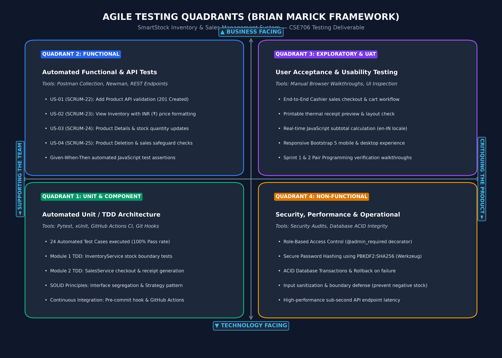

# Step 4: Testing and Validation Deliverable
**Course**: CSE706 - Agile Development of a Mini Software Product using Scrum Framework  
**Project**: SmartStock Inventory Management System  
**Deliverable**: Step 4 - Acceptance Criteria, Automated API Testing (Postman), and Agile Testing Quadrants  

---

## 4.1 Acceptance Criteria for User Stories (Jira Mapped)

### US-01 (SCRUM-22): Add New Product
- **Epic**: `SCRUM-18` (Product Inventory Management)
- **User Story**: *As an Store Administrator, I want to add new products with SKU, prices, and initial quantities, so that new inventory can be cataloged and tracked.*
- **Acceptance Criteria**:
  1. **AC-1.1 (Required Fields)**: `sku` and `name` must be non-empty strings.
  2. **AC-1.2 (Uniqueness)**: `sku` must be globally unique across all catalog products.
  3. **AC-1.3 (Pricing Invariants)**: `cost_price >= 0` and `selling_price > 0`.
  4. **AC-1.4 (Inventory Invariants)**: `quantity >= 0` and `reorder_level >= 0`.
  5. **AC-1.5 (Audit Logging)**: When opening quantity > 0, an automatic `IN` movement is recorded.
  6. **AC-1.6 (HTTP Response)**: Successful creation returns HTTP `201 Created` with the complete product payload.

### US-02 (SCRUM-23): View Product Inventory
- **User Story**: *As a Cashier/Admin, I want to view current product stock levels and formatted prices, so that I can see inventory availability in real-time.*
- **Acceptance Criteria**:
  1. **AC-2.1 (Listing)**: Returns a complete array of all active products with pagination/count.
  2. **AC-2.2 (Currency Formatting)**: Prices are rendered with Indian Rupee formatting (`₹`).
  3. **AC-2.3 (Stock Indicators)**: Includes `is_low_stock` boolean flag based on `reorder_level`.
  4. **AC-2.4 (Search & Filter)**: Supports substring query matching by product name and SKU (`?q=query`).
  5. **AC-2.5 (Single Retrieval)**: Returns individual product details by ID or `404 Not Found`.

### US-03 (SCRUM-24): Update Product Details
- **User Story**: *As an Administrator, I want to edit product pricing, details, and stock quantities, so that records accurately reflect updated warehouse state.*
- **Acceptance Criteria**:
  1. **AC-3.1 (Authorization)**: Only authenticated users with `admin` role can edit products.
  2. **AC-3.2 (Stock Reconciliation)**: Quantity changes automatically record either an `IN` or `OUT` movement in `StockMovement`.
  3. **AC-3.3 (Data Integrity)**: Updates cannot set negative stock or zero selling price.
  4. **AC-3.4 (HTTP Response)**: Returns HTTP `200 OK` with the updated product entity.

### US-04 (SCRUM-25): Delete Product
- **User Story**: *As an Administrator, I want to remove obsolete products from the catalog, so that discontinued items are no longer shown.*
- **Acceptance Criteria**:
  1. **AC-4.1 (Authorization)**: Requires `admin` role privileges.
  2. **AC-4.2 (Safeguard Check)**: Products with historical sales transactions (`sale_items`) cannot be deleted; returns `400 Bad Request`.
  3. **AC-4.3 (Cascade Cleanup)**: Associated stock movements without sales are cleanly removed.
  4. **AC-4.4 (Verification)**: Subsequent `GET /api/products/<id>` returns `404 Not Found`.

---

## 4.2 Automated Functional Testing via Postman (API)

### Postman Test Suite Assets
- **Collection File**: `postman/SmartStock_API_Tests.postman_collection.json`
- **PowerShell Automated Test Runner**: `postman/run_postman_tests.ps1`

### Execution Output:
```text
================================================================
   SmartStock Automated API Testing Suite (Postman Runner)     
================================================================

[STEP 0] Authenticating Admin...
  -> Result: Authentication successful | User: Demo Admin (admin)

[US-01 (SCRUM-22)] Add New Product...
  -> Product Created ID: 4
  -> SKU: KB-RGB-545
  -> Formatted Price: ₹3,999.00
  -> Initial Quantity: 20

[US-02 (SCRUM-23)] View Product Inventory...
  -> Total Products in Inventory: 4
  -> Retrieved By ID: Mechanical Gaming Keyboard RGB (KB-RGB-545)

[US-03 (SCRUM-24)] Update Product Details...
  -> Updated Name: Mechanical Gaming Keyboard RGB (Updated Pro V2)
  -> Updated Price: ₹4,499.00
  -> Updated Quantity: 35

[US-04 (SCRUM-25)] Delete Product...
  -> Result: Product deleted successfully (ID: 4)
  -> Verified Deletion: HTTP 404 Not Found (Correct)

================================================================
  [SUCCESS] All 4 User Stories Passed Automated API Validation! 
================================================================
```

---

## 4.3 Agile Testing Quadrants (Brian Marick Framework)

SmartStock adopts the **Agile Testing Quadrants** model to balance business-facing and technology-facing tests across automated and manual spectrums:



```text
               Business Facing
                     ▲
                     │
       Q2: Functional Testing │   Q3: User Acceptance &
       - Postman API Tests    │       Exploratory Testing
       - Acceptance Criteria  │   - Manual UI walkthroughs
       - User Stories (US 1-4)│   - Receipt Print previews
                     │   - Usability assessment
Supporting           ┼────────────────────────► Critique
the Team             │                          Product
       Q1: Automated Unit/TDD │   Q4: Non-Functional Testing
       - Pytest (19+ tests)   │   - Security & Auth checks
       - SOLID Service tests  │   - Database constraints
       - Pre-Commit Git Hook  │   - Response latency benchmarks
       - GitHub Actions CI    │
                     │
                     ▼
              Technology Facing
```

### Quadrant Breakdown:
1. **Quadrant 1 (Technology-Facing, Supporting the Team)**:
   - **Tools**: `Pytest`, `xUnit`, GitHub Actions CI, Git Pre-Commit Hook.
   - **Scope**: Unit tests for `InventoryService`, `SalesService`, and `PaymentStrategies`. Verifies code correctness, SOLID adherence, and regression prevention.
2. **Quadrant 2 (Business-Facing, Supporting the Team)**:
   - **Tools**: `Postman`, `Newman`, REST API endpoints.
   - **Scope**: Functional testing of user stories (SCRUM-22 through SCRUM-25) against explicit Given-When-Then acceptance criteria.
3. **Quadrant 3 (Business-Facing, Critiquing the Product)**:
   - **Tools**: Browser inspection, User walkthroughs.
   - **Scope**: Validates user experience, cashier checkout flow, receipt printing, and visual layout.
4. **Quadrant 4 (Technology-Facing, Critiquing the Product)**:
   - **Tools**: Role-based access control tests, database transaction rollback checks, concurrency safety on stock deductions.

